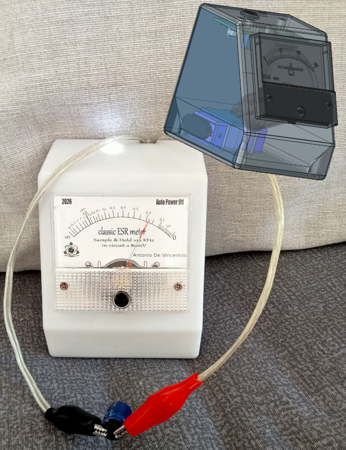
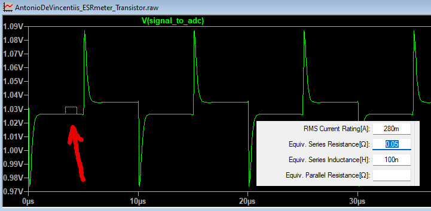
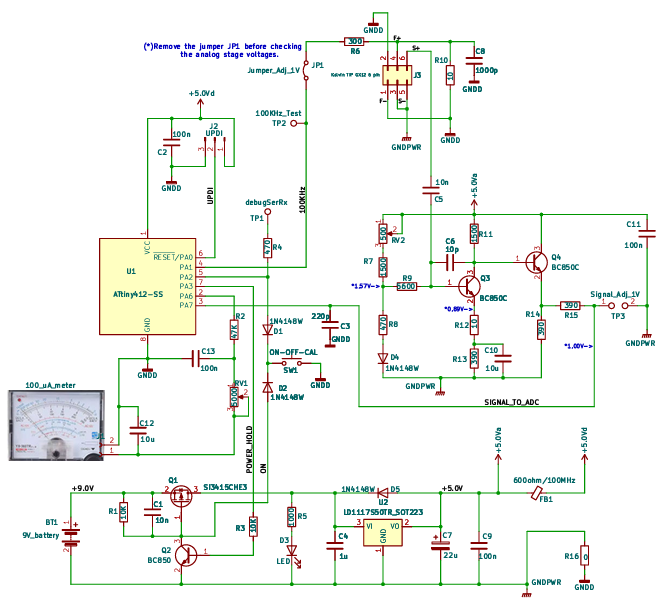
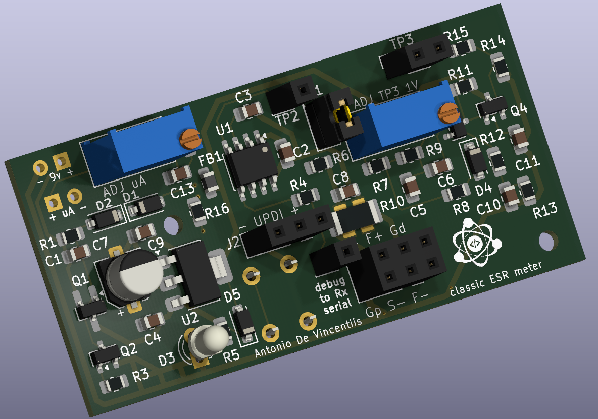
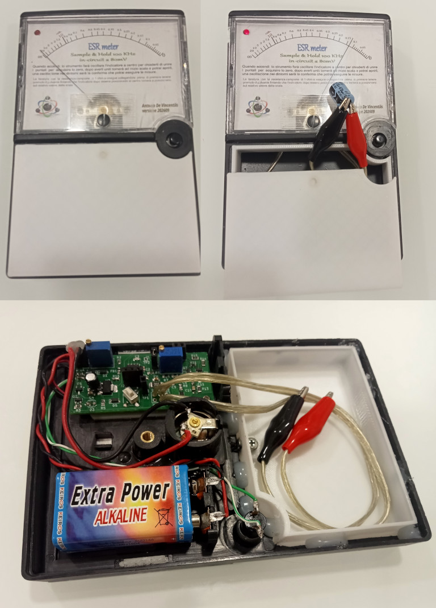

# 🛠️ Classic ESR meter
In-Circuit ESR Meter standalone ATtiny412 platform.

[](https://www.microchip.com)
[](https://github.com/SpenceKonde/megaTinyCore)
[](LICENSE)

---

## 🌍 Language / Lingua
Select your preferred language:
* 🇬🇧 [English Version](#-english-version)
* 🇮🇹 [Versione Italiana](#-versione-italiana)

---

*ESRmeter 85C1 100uA - Case Model T*
## 🇬🇧 English Version

### The innovation:💡
What distinguishes this from the many other circuit solutions found online is the inclusion of a 10 Ω resistor in parallel with the electrolytic capacitor under test. While this prevents ESR measurements beyond a few tens of ohms (which are of no practical use), it offers significant advantages: it creates a resistive voltage divider that eliminates the need for constant-current generators, limits the maximum voltage across the component, allows the capacitor to discharge as quickly as it charges, and provides better protection than the standard pair of anti-parallel diodes.

A complete project (Hardware, Firmware, and 3D files) to build a **high-precision analog ESR Meter** optimized for direct *in-circuit* measurements (without desoldering capacitors). The instrument can resolve variations down to **0.01 Ω** in the critical zone of the scale, extending its logarithmic readout up to **20 Ω**.

The software architecture is developed in C++ for the **ATtiny412** using the Arduino IDE (via the `megaTinyCore` library). It performs deterministic sampling at 100 kHz without requiring external Sample & Hold components, using only signal conditioning/amplification through two common BC850C low-noise transistors.

### 🚀 Key Features
* **Realistic In-Circuit Measurement:** Operates at a low excitation voltage to prevent surrounding semiconductor junctions from turning on during in-circuit testing.
* **Synchronous S&H Sampling (Anti-ESL):** Utilizes the hardware **Event System** integrated into AVR 1-series MCUs to synchronize ADC0 with the 100 kHz square wave timer. By sampling exactly ~3 µs after the cycle start, the instrument isolates the ESR, eliminating parasitic inductive reactance (ESL) spikes.
* **Oversampling and Advanced Filtering:** Executes 64x hardware oversampling combined with a software **EMA (Exponential Moving Average)** filter to guarantee a perfectly stable, vibration-free meter needle.
* **Fixed-Point Logarithmic Scale:** Fast polynomial approximation maps ESR values onto the analog microammeter, ensuring extremely high sub-ohm resolution while expanding readability up to 20 Ω.
* **Smart Power Management (Kill-Switch):** Total shutdown via a Latch MOSFET paired with an auto-power-off feature ensures ~0 mA parasitic current draw in standby.



### ⏳ History

This project was born to solve a well-known issue in electronics troubleshooting: making precise, in-circuit ESR measurements without desoldering components. The initial goal was ambitious yet budget-friendly: creating a tool capable of 0.01 Ω sensitivity without relying on expensive and complex microcontrollers.

The development took a few months and progressed through these key milestones:

* **1. Genesis & Simulation:** The initial concept featured fast operational amplifiers and a precision rectifier. SPICE simulations validated the theory, producing millivolt outputs perfectly readable by a 10-bit ADC (ranging from 0.2 mV for 0.01 Ω up to over 400 mV for 20 Ω).
* **2. The Inductance (ESL) Challenge:** Deeper simulation revealed that inductive reactance caused unwanted voltage spikes on the edges of the 100 kHz square wave. This was solved by replacing the standard rectifier with a delayed *Sample & Hold* approach, bypassing the first 3 µs of spikes to sample only the clean plateau.
* **3. Hardware Simplification & Thermal Compensation:** To lower production costs, the external S&H circuit was replaced by utilizing the MCU's internal ADC, conditioning the signal with just two common BJT transistors. To prevent thermal drift from affecting low-range readings, a compensation diode was added. The firmware checks this at boot, warning the user via a sweeping meter needle if the offset shifts outside the 0.95V - 1.05V tolerance.
* **4. Lab Testing & Real-World Validation:** Once the definitive PCBs arrived, real-world tests exceeded expectations. Pairing the board with custom-made, low-cost Kelvin probes allowed the ADC to resolve variations down to 3.33 mΩ.
* **5. Firmware & Dual-Scale Optimization:** The final challenge was fitting the software into an ultra-cheap 50-cent MCU (ATtiny412). By heavily optimizing timers and ADC registers to sample within 1-2 µs, the firmware takes up just 80% of the memory. It implements an intelligent dual-scale system: Scale 1 (0.01 Ω to 1.00 Ω) for maximum precision, and Scale 2 (1 Ω to 20 Ω) for general readings.


### 📐 Pinout & Connections (ATtiny412)

| Pin | Name | Type | Main Function |
| :---: | :---: | :---: | :--- |
| **1** | VDD | Power | +5V Power Supply |
| **2** | PA6 | Output | ~610 Hz Analog PWM Output (Microammeter Control) |
| **3** | PA7 | Input | ADC0 Analog Input / AIN7 Channel (ESR Sensor) |
| **4** | PA1 | Output | 100 kHz Hardware Square Wave Generation (TCA0) |
| **5** | PA2 | Input | Multi-function Button Input (On/Off/Calibration) / Serial in MODE 1 |
| **6** | PA0 | I/O | UPDI Programming Line |
| **7** | PA3 | Output | Latch MOSFET Control (Power Hold) |
| **8** | GND | Power | Common Circuit Ground |

### 🔧 Configuration and Calibration Guide (FIRMWARE_USAGE_MODE)
The firmware implements a guided calibration sequence managed via the `#define FIRMWARE_USAGE_MODE` macro at the top of the sketch:

#### 🟩 Step 1: MODE 0 - Static Hardware Calibration
Set the macro to `0` and upload the firmware. The 100 kHz carrier is deactivated, and the PWM output to the analog meter is forced to its maximum value (`1023`).
1. Rotate the hardware trimmer **RV2** until you measure exactly **1.000 V** at the `SIGNAL_TO_ADC` test point (BJT sensor bias voltage).
2. Adjust trimmer **RV1** to force the needle of your analog microammeter (e.g., 100µA or 1mA) precisely to the full-scale **0 Ω** mark.

#### 🟦 Step 2: MODE 1 - Debug and Constant Acquisition
Set the macro to `1` and upload the firmware. This mode activates the 100 kHz signal and enables a software serial port on pin `PA2` at 9600 baud.
1. Connect a USB-TTL converter (Converter Rx to MCU pin PA2).
2. Open the Serial Monitor and note the `ADC_RAW` value with shorted probes (`ADC_ZERO`, typically ~945) and open probes (`ADC_OPEN`, typically ~130).
3. If your real-world values differ from the default ones, update the definitions at the top of the sketch before the final flash.

#### 🟥 Step 3: MODE 2 - Final Operational Instrument
Set the macro to `2` and upload the final sketch. The instrument is now ready for laboratory use.

### 🎮 Interface and EEPROM Calibration (Operational Phase)
* **Boot Self-Test:** At power-on, short the probes when the needle swings to mid-scale. Then, open the probes when it swings close to zero. The instrument automatically corrects the offset by detecting the ambient thermal drift.
* **1-Ohm Reference Saving:** Connect a precision 1 Ω resistor to the probes and hold down the power button for more than 2 seconds. The firmware validates the reading using a geometric stability filter and stores the value in the **EEPROM**, instantly updating the logarithmic curve.
* **Short Press:** Pressing the button during normal operation instantly turns off the device, electronically isolating the pin to prevent bounces.
---
### ⚡ Schematic / Schema Elettrico



🖨️ _Print or zoom?_ 
👉 **[Open high resolution schematic / Apri ad alta risoluzione (PDF)](./hardware/AntonioDeVincentiis_classicESRmeter/AntonioDeVincentiis_classicESRmeter.pdf)**


---



---

## 🇮🇹 Versione Italiana

### L'innovazione 💡
La differenza con le molte altre soluzioni circuitali reperibili sulla rete internet è l’aver introdotto una resistenza da 10 Ω in parallelo al condensatore elettrolitico da testare, essa non consente la misura ESR oltre alcune decine di Ohm (inutili) ma offre il notevole vantaggio di costituire un partitore resistivo che non necessita di generatori di corrente costante, limita la tensione massima ai suoi capi, consente una scarica veloce quanto la carica ed offre una protezione migliore dei classici due diodi in antiparallelo.

Un progetto completo (Hardware, Firmware e 3D) per la realizzazione di un **ESR Meter analogico ad alta precisione** ottimizzato per misure dirette *in-circuit* (senza dissaldare i condensatori). Lo strumento è capace di discriminare variazioni fino a **0.01 Ω** nella zona critica della scala, estendendo la lettura logaritmica fino a **20 Ω**.

L'architettura software è sviluppata in C++ per **ATtiny412** tramite Arduino IDE (grazie alla libreria `megaTinyCore`) ed esegue un campionamento deterministico a 100 kHz senza l'ausilio di componenti esterni di Sample & Hold ma il solo condizionamento/amplificazione del segnale attraverso due comunissimi transistor a basso rumore BC850C.

### 🚀 Caratteristiche Principali
* **Misura In-Circuit Realistica:** Lavora a bassa tensione di eccitazione per evitare l'apertura delle giunzioni dei semiconduttori circostanti durante il test sulla scheda.
* **Campionamento Sincrono S&H (Anti-ESL):** Sfrutta l'**Event System** hardware integrato negli AVR serie 1 per sincronizzare l'ADC0 con il timer dell'onda quadra a 100 kHz. Campionando esattamente a circa 3 µs dall'inizio del ciclo, lo strumento isola la ESR eliminando gli spike parassiti della reattanza induttiva (ESL).
* **Oversampling e Filtraggio Avanzato:** Esegue un sovracampionamento hardware 64x combinato a un filtro software **EMA (Exponential Moving Average)** per garantire una lancetta perfettamente stabile e priva di vibrazioni.
* **Scala Logaritmica in Virgola Fissa:** Approssimazione polinomiale rapida per mappare i valori di ESR sul microamperometro analogico, garantendo un'altissima risoluzione sotto l'ohm ed espandendo la leggibilità fino a 20 Ω.
* **Gestione Power Intelligente (Kill-Switch):** Lo spegnimento totale tramite Latch MOSFET unito alla funzione di auto-spegnimento garantisce un azzeramento di consumi parassiti in standby di ~0 mA.


### ⏳ Storia

Il progetto nasce per risolvere un problema comune nell'hobby dell'elettronica: misurare con precisione l'ESR direttamente in-circuit senza dover dissaldare i componenti. L'obiettivo iniziale era sviluppare uno strumento economico, capace di raggiungere una sensibilità di 0.01 Ω senza l'uso di microcontrollori complessi.

Ecco le tappe fondamentali dello sviluppo, durato alcuni mesi:

* **1. Genesi e Simulazione:** Il concetto iniziale prevedeva amplificatori operazionali veloci e un raddrizzatore di precisione. Le simulazioni SPICE hanno confermato la fattibilità teorica, mostrando segnali in millivolt perfettamente discriminabili da un ADC a 10 bit (da 0.2 mV per 0.01 Ω a oltre 400 mV per 20 Ω).
* **2. Il Problema dell'Induttanza (ESL):** Durante l'approfondimento delle simulazioni è emerso che la reattanza induttiva generava spike di tensione sui fronti dell'onda quadra a 100 kHz. Il problema è stato aggirato sostituendo il raddrizzatore classico con una tecnica di *Sample & Hold* ritardato, campionando il plateau pulito del segnale dopo i primi 3 µs di spike.
* **3. Ottimizzazione Hardware e Compensazione Termica:** Per ridurre i costi, l'S&H esterno è stato integrato sfruttando l'ADC nativo della MCU, condizionando il segnale con soli due transistor BJT. Per contrastare la deriva termica sulle letture più basse, è stato introdotto un diodo di compensazione; il firmware esegue un controllo all'avvio e avvisa l'utente se l'offset supera la tolleranza (0.95V - 1.05V).
* **4. Test Reali e Laboratorio:** Con l'arrivo dei PCB definitivi e l'adozione di puntali Kelvin autocostruiti, i test reali hanno confermato la capacità dell'ADC di discriminare variazioni fino a 3.33 mΩ, superando le aspettative iniziali.
* **5. Sviluppo del Firmware (ATtiny412):** L'intero codice è stato ottimizzato per risiedere in una MCU ultra-economica da 50 centesimi. Sfruttando al massimo i timer e i registri dell'ADC per campionare entro 1-2 µs, il firmware occupa appena l'80% della memoria e gestisce una doppia scala intelligente (0.01 Ω - 1.00 Ω per la massima precisione e 1 Ω - 20 Ω per range esteso).


### 📐 Schema dei Collegamenti (Pinout ATtiny412)

| Pin | Nome | Tipo | Funzione Principale |
| :---: | :---: | :---: | :--- |
| **1** | VDD | Power | Alimentazione +5V |
| **2** | PA6 | Output | Uscita analogica PWM a ~610 Hz (Controllo Microamperometro) |
| **3** | PA7 | Input | Ingresso analogico ADC0 / Canale AIN7 (Sensore ESR) |
| **4** | PA1 | Output | Generazione hardware onda quadra a 100 kHz (TCA0) |
| **5** | PA2 | Input | Ingresso pulsante multifunzione (On/Off/Calibrazione) / Seriale in MODO 1 |
| **6** | PA0 | I/O | Linea di programmazione UPDI |
| **7** | PA3 | Output | Controllo Latch MOSFET (Mantenimento alimentazione) |
| **8** | GND | Power | Massa comune del circuito |

### 🔧 Guida alla Configurazione e Taratura (FIRMWARE_USAGE_MODE)
Il firmware implementa una sequenza di calibrazione guidata gestibile tramite la macro `#define FIRMWARE_USAGE_MODE` presente in cima sullo sketch:

#### 🟩 Passo 1: MODO 0 - Taratura Statica Hardware
Imposta la macro a `0` e carica il firmware. La portante a 100 kHz viene disattivata e l'uscita PWM verso lo strumento analogico viene forzata al valore massimo (`1023`).
1. Ruota il trimmer hardware **RV2** finché non misuri esattamente **1.000 V** sul test-point `SIGNAL_TO_ADC` (Tensione di bias del sensore BJT).
2. Regola il trimmer **RV1** per forzare la lancetta del tuo microamperometro analogico (es. 100µA o 1mA) precisamente sul fondo scala dei **0 Ω**.

#### 🟦 Passo 2: MODO 1 - Debug e Acquisizione Costanti
Imposta la macro a `1` e carica il firmware. Questa modalità attiva i 100 kHz e abilita una porta seriale software sul pin `PA2` a 9600 baud.
1. Collega un convertitore USB-TTL (Rx del convertitore al pin PA2 della MCU).
2. Apri il Serial Monitor e annota il valore di `ADC_RAW` a puntali uniti (`ADC_ZERO`, tipicamente ~945) e a puntali aperti (`ADC_OPEN`, tipicamente ~130).
3. Se i tuoi valori reali si scostano da quelli di fabbrica, aggiorna le definizioni in cima allo sketch prima dell'ultimo flash.

#### 🟥 Passo 3: MODO 2 - Strumento Operativo Definitivo
Imposta la macro a `2` e carica lo sketch finale. Lo strumento è pronto per l'uso in laboratorio.

### 🎮 Interfaccia e Calibrazione in EEPROM (Fase Operativa)
* **Autotesta al Boot:** All'accensione, unisci i puntali quando la lancetta oscilla a metà scala. Successivamente riapri i puntali quando oscilla vicino allo zero. Lo strumento corregge autonomamente l'offset rilevando la deriva termica ambientale del momento.
* **Salvataggio Campione (1 Ohm):** Collega una resistenza campione da 1 Ω di precisione ai puntali e tieni premuto il pulsante di accensione per più di 2 secondi. Il firmware convaliderà la lettura tramite un filtro geometrico di stabilità e memorizzerà il valore nella **EEPROM**, aggiornando istantaneamente la curva logaritmica.
* **Pressione Corta:** Se premuto durante il normale funzionamento, spegne istantaneamente il dispositivo isolando elettronicamente il pin per evitare rimbalzi.


## 📦 Repository Content / Contenuto del Repository

```text
├── Firmware/
│   └── AntonioDeVincentiis_classicESRmeter.ino  # Arduino source code / Codice sorgente Arduino
├── Hardware/                                    # KiCad schematic and PCB layout files / File schema ed elettrico e PCB
└── Case/                                        # FreeCAD source files & SVG vector scales / File sorgenti FreeCAD e scale SVG
```

## 📝 License / Licenza

Questo progetto è rilasciato sotto licenza MIT - consulta il file [LICENSE](LICENSE) per ulteriori dettagli.  
This project is licensed under the MIT License - see the [LICENSE](LICENSE) file for details.

---

## 🤝 Ringraziamenti / Acknowledgments

* **AI Collaboration:** Un ringraziamento speciale all'assistente AI di Google per aver collaborato attivamente allo sviluppo di questo progetto, accelerando notevolmente le fasi di ricerca, ottimizzazione del codice firmware e stesura della documentazione tecnica.
* **AI Collaboration:** A special thanks to Google's AI assistant for actively collaborating on this project, significantly accelerating the research, firmware code optimization, and technical documentation drafting.

---

## Reuse and creations
*ESRmeter old & reused YX-360TRn tester*

